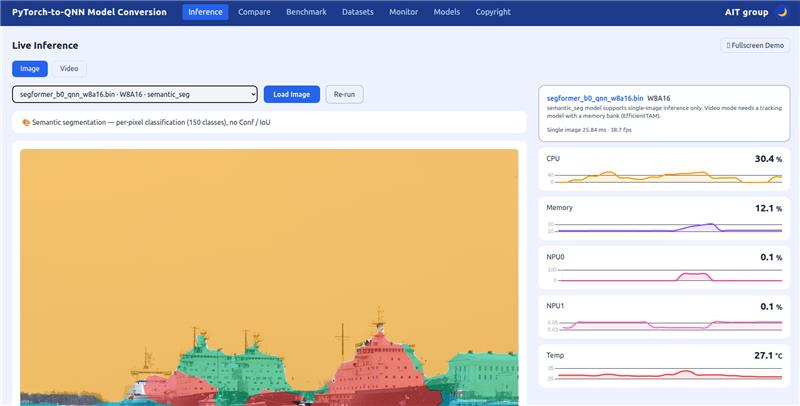
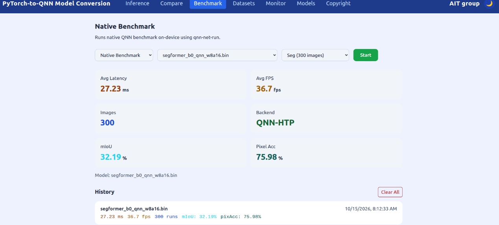

# Qualcomm IQ-9075 Edge AI One-Touch SegFormer Segmentation Model Migration Toolkit

## Advantages of IQ-9075

1. IQ-9075 can provide up to 200 sparse TOPS of AI computing power and supports GPU and DSP accelerated computing
2. The Qualcomm Neural Processing (SNPE) SDK and the Qualcomm AI Engine Direct (QNN) can optimize the performance of trained neural networks
3. It supports Yocto and Ubuntu for AI development

## Performance Metrics

- **AI Model**: SegFormer-B0 (ADE20K, 150 classes, 512 × 512) — Semantic Segmentation (QNN)

| Model | Precision | mIoU | Pixel Accuracy | Latency on IQ-9075 (HTP) |
|---|---|---|---|---|
| ONNX (Host PC) | FP32 | 32.02% | 75.93% | — |
| QNN | W8A16 | 32.19% | 75.98% | 27.23 ms |

Evaluated on 300 images of the ADE20K validation set. On-device latency is measured with `qnn-net-run` on the HTP backend.

## Hardware

- **Platform**:  [Qualcomm IQ-9075 EVK](https://www.qualcomm.com/developer/hardware/qualcomm-iq-9075-evaluation-kit-evk)
- **Host PC**: Ubuntu x86_64 PC with NVIDIA RTX 30/40 series GPU, connected to the EVK over USB (ADB)

## Software & Toolkit

- **Qualcomm AI Runtime (QAIRT) SDK**：v2.44.0 (conversion) / v2.47.0 (on-device runtime)
- **System:** Yocto (Qualcomm Linux)
- **Host OS:** Ubuntu 22.04

## Background & Solution

### Motivation

- Creating a One-Touch Toolkit to show Qualcomm Edge AI strength on Transformer-based semantic segmentation for scene understanding

### Solution

- One-touch PyTorch-to-QNN model conversion for SegFormer-B0 (W8A16), with optional AIMET post-training quantization
- On-device QNN benchmark on IQ-9075 EVK: latency, mIoU and pixel accuracy
- Live per-pixel semantic segmentation (150 classes) in the browser

## Architecture Diagram

The architecture diagram shows the toolkit workflow, corresponding to the colors in the legend on the left

Blue Phase: Convert the PyTorch model into a QNN model, and evaluate the benchmark for the QNN model

Purple Phase: Perform real-time inference and display the results based on the converted QNN model

## Demo

Live semantic segmentation with the W8A16 QNN model on IQ-9075 EVK

Native benchmark on the IQ-9075 NPU (latency, mIoU and pixel accuracy)

## Contact
If you require any further information, please feel free to contact:

TW: qualcomm.tw@aitgroup.com.tw

CN: qualcomm.cn@aitgroup.com.tw
